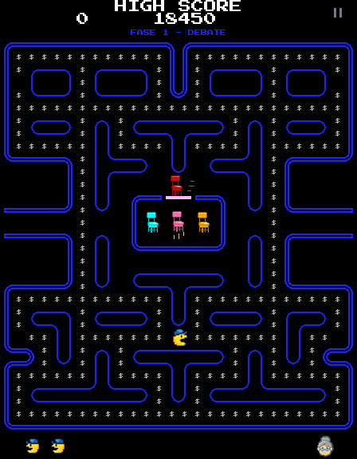
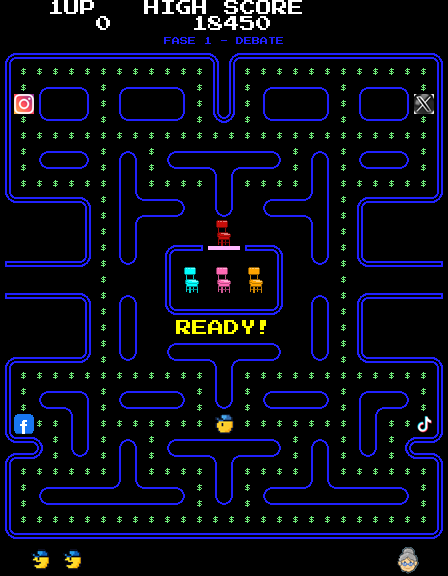
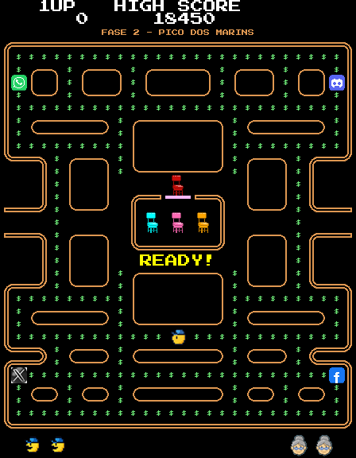
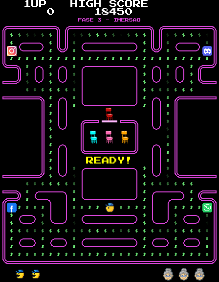
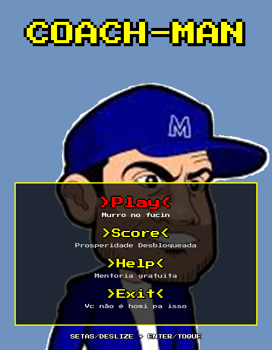
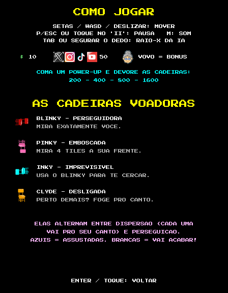
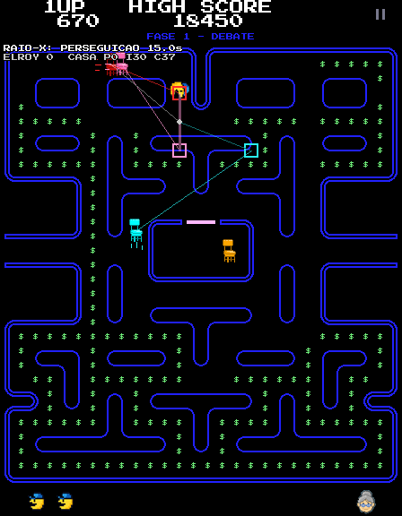

# 🎮 Coach-Man

**Um Pac-Man brasileiro em que os fantasmas são cadeiras voadoras.**
Feito em **Python** (pygame-ce) e jogável **direto no navegador** — o Python
roda em WebAssembly, sem baixar nem instalar nada.

### [▶️ Jogar agora](https://lucasmsorrentino.github.io/coachman/)

[](https://github.com/lucasmsorrentino/coachman/actions/workflows/pages.yml)



> Funciona no computador (teclado) e no celular (deslize o dedo).
> Não há executável para baixar: o jogo roda dentro da página, isolado pelo
> navegador.

---

## ✨ O que tem no jogo

- **Jogabilidade fiel ao arcade de 1980**: velocidades e tempos de cada fase
  tirados do *Pac-Man Dossier*, curva antecipada (*cornering*), pausa de 1
  quadro ao comer, túneis que freiam as cadeiras, vida extra aos 10.000 pontos.
- **A IA original dos fantasmas**, com as 4 personalidades (perseguidora,
  emboscada, imprevisível e desligada), modos de dispersão/perseguição, modo
  assustado, *Cruise Elroy* e as regras de saída da casa —
  [explicada em detalhes aqui](docs/FANTASMAS.md).
- **Modo Raio-X** (tecla `TAB` ou segurar o dedo na tela): mostra em tempo real
  o alvo de cada cadeira — a melhor forma de entender a IA.
- **3 labirintos** que se alternam a cada fase, com dificuldade crescente.
- Power-ups com **logos de redes sociais** sorteados a cada fase, "$" no lugar
  das bolinhas e a **vovó** como "frutinha" de bônus.
- Placar dos 10 melhores com iniciais no estilo arcade.
- **61 testes automatizados** e deploy contínuo no GitHub Pages.

| Fase 1 — Debate | Fase 2 — Pico dos Marins | Fase 3 — Imersão |
|---|---|---|
|  |  |  |

| Menu | Como jogar | Raio-X da IA |
|---|---|---|
|  |  |  |

## 🕹️ Controles

| Ação | Teclado | Celular / tablet (ou mouse) |
|---|---|---|
| Mover | setas ou `W` `A` `S` `D` | deslizar o dedo |
| Confirmar | `Enter` / `Espaço` | tocar |
| Pausar | `P` ou `Esc` | tocar no `II` (canto superior direito) |
| Raio-X da IA | `Tab` ou `X` | segurar o dedo parado |
| Som liga/desliga | `M` | — |
| Tela cheia | `F` ou `F11` | — |

## 🪑 Como as cadeiras pensam (resumo)

Cada cadeira tem um **tile-alvo** e, em cada cruzamento, escolhe a saída que
fica mais perto do alvo em linha reta — sem nunca dar meia-volta. O que muda
de uma para outra é só o alvo:

| | Cadeira | Alvo no modo perseguição |
|---|---|---|
| 🔴 | **Blinky** | o próprio Coach-Man |
| 🩷 | **Pinky** | 4 tiles à frente do Coach-Man |
| 🩵 | **Inky** | o vetor Blinky → (2 tiles à frente), dobrado |
| 🟠 | **Clyde** | o Coach-Man, mas foge para o canto quando chega a menos de 8 tiles |

Explicação completa, com diagramas, tabelas de tempo e referências:
**[docs/FANTASMAS.md](docs/FANTASMAS.md)**.

## 🏗️ Engenharia

O código foi reescrito com **padrões de projeto consagrados**, citados no
próprio código e documentados em **[docs/ARQUITETURA.md](docs/ARQUITETURA.md)**:

| Padrão | Uso |
|---|---|
| **State** (GoF) | modos das cadeiras; telas do jogo (com pilha, para a pausa) |
| **Strategy** (GoF) | as 4 personalidades das cadeiras |
| **Template Method** (GoF) | o algoritmo de movimento do arcade, comum ao jogador e às cadeiras |
| **Observer** (GoF) | eventos do jogo → placar, som, casa das cadeiras |
| **Command** (GoF) | teclado, toque e controle viram comandos |
| **Factory** (GoF) | criação das entidades e escolha de implementações por plataforma |
| **Flyweight** (GoF) | atlas de sprites e estados compartilhados |
| **Facade + Singleton + Null Object** | o sistema de áudio |
| **Repository** (Fowler) | recordes em SQLite (computador) ou `localStorage` (navegador) |
| **Game Loop** (Nystrom) | passo fixo de 1/60 s, como o arcade |

A lógica do jogo não desenha nem toca som — só publica eventos —, então é
testada inteira sem abrir janela.

## 🚀 Rodando localmente

**No computador (Python 3.11+):**

```bash
pip install -r requirements.txt
python coachman/main.py
```

**Versão web, localmente:**

```bash
pip install pygbag
python -m pygbag --no_opt --template web/coachman.tmpl --icon coachman/favicon.png coachman
# abra http://localhost:8000
```

**Testes:**

```bash
pip install -r requirements-dev.txt
python -m pytest
```

**Publicar no GitHub Pages:** em *Settings → Pages → Build and deployment*,
escolha **Source: GitHub Actions**. A cada push na `main`, o workflow
[`pages.yml`](.github/workflows/pages.yml) roda os testes, empacota o jogo com
o pygbag e publica.

**Regerar a arte e os sons** (a partir dos originais em `assets-src/original/`):

```bash
pip install pillow   # e ffmpeg instalado
python tools/build_assets.py
python tools/screenshots.py   # imagens deste README
```

## 📁 Estrutura

```
├── coachman/               # o jogo (é esta pasta que vai para o navegador)
│   ├── main.py             # ponto de entrada
│   ├── game/               # código: core/, world/, actors/, systems/, scenes/, ui/...
│   └── assets/             # sprites, sons e fontes gerados pelo pipeline
├── assets-src/original/    # arte e áudio originais, intocados
├── tools/                  # pipeline de assets e gerador de screenshots
├── tests/                  # pytest
├── web/coachman.tmpl       # página HTML do pygbag (personalizada)
└── docs/                   # FANTASMAS.md, ARQUITETURA.md, ARTE.md
```

## 🕰️ Histórico

- **v1** — trabalho da disciplina de ADS: Python + Pygame, fantasmas com A\*,
  distribuído como `.exe`. O código dessa versão continua no histórico do Git:
  [commit `65f0c8a`](https://github.com/lucasmsorrentino/coachman/tree/65f0c8af25a53a3122cb55e32a5f795a933e5394).
- **v2** — reescrita completa: jogabilidade e IA fiéis ao arcade, padrões de
  projeto, testes, 3 labirintos, arte refinada e versão web (sem `.exe`).

Detalhes da arte e do som: [docs/ARTE.md](docs/ARTE.md).

## 📝 Créditos

- Criação, tema e arte original: **Lucas Martins Sorrentino**.
- O jogo é uma **paródia humorística**, sem fins comerciais, inspirada no
  influenciador Pablo Marçal e no episódio da "cadeirada". Imagens, áudios e
  marcas de terceiros (incluindo os logos das redes sociais) pertencem aos
  seus respectivos donos.
- *Pac-Man* é marca da Bandai Namco; o primeiro labirinto é uma homenagem ao
  original.
- Fonte **Press Start 2P** — The Press Start 2P Project Authors, SIL Open Font License 1.1.
- Referências da IA: Jamey Pittman, *The Pac-Man Dossier*; Chad Birch,
  *Understanding Pac-Man Ghost Behavior*.
- Web: [pygbag](https://github.com/pygame-web/pygbag) e
  [pygame-ce](https://github.com/pygame-community/pygame-ce).

## 📜 Licença

Projeto acadêmico, desenvolvido com fins educacionais.

---

Divirta-se com o **Coach-Man** e desbloqueie a prosperidade fugindo das
cadeiras voadoras! 💪🪑
