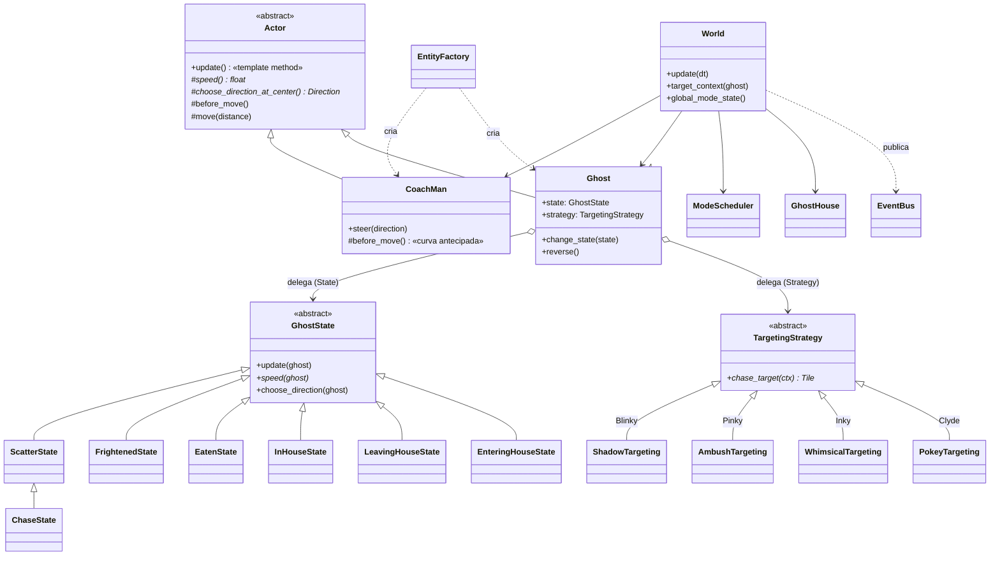

# 🏗️ Arquitetura e padrões de projeto

Este documento mostra **como o código está organizado** e **quais padrões de
projeto** foram usados, com o motivo de cada um e o arquivo onde ele aparece.
Os comentários no topo de cada arquivo citam o padrão e a referência.

## Visão geral

```
coachman/                       ← pasta do jogo (o pygbag empacota só ela)
├── main.py                     ← ponto de entrada (async, exigência do navegador)
├── favicon.png
├── assets/                     ← gerado por tools/build_assets.py (não editar)
└── game/
    ├── app.py                  ← App: janela, laço, pilha de telas, raiz de composição
    ├── config.py               ← constantes (geometria do arcade, cores, pontuação)
    ├── levels.py               ← tabela de dificuldade por fase (dados do arcade)
    ├── core/                   ← motor genérico, não sabe nada de Pac-Man
    │   ├── loop.py             ← Game Loop (passo fixo)
    │   ├── events.py           ← Observer (EventBus + eventos)
    │   ├── commands.py         ← Command (teclado/toque/controle → comandos)
    │   ├── scenes.py           ← State (telas) + pilha (pushdown automaton)
    │   ├── assets.py           ← Flyweight (atlas de sprites, fontes, textos)
    │   └── audio.py            ← Facade + Singleton + Null Object
    ├── world/                  ← o "domínio": regras do jogo, sem desenho
    │   ├── direction.py        ← Value Object
    │   ├── maze.py             ← modelo do labirinto + validação
    │   ├── maze_data.py        ← os labirintos (fases) em texto
    │   └── world.py            ← uma fase em andamento (Mediator)
    ├── actors/
    │   ├── actor.py            ← Template Method (movimento de centro em centro)
    │   ├── coachman.py         ← o jogador (curva antecipada etc.)
    │   ├── ghost.py            ← cadeira voadora (Context do State e do Strategy)
    │   ├── ghost_states.py     ← State (dispersão, perseguição, assustada...)
    │   ├── targeting.py        ← Strategy (personalidade de cada cadeira)
    │   └── factory.py          ← Factory (monta Coach-Man e cadeiras)
    ├── systems/
    │   ├── mode_scheduler.py   ← relógio dispersão/perseguição/susto
    │   ├── ghost_house.py      ← quem sai da casa e quando
    │   └── session.py          ← placar e vidas (assinante do Observer)
    ├── persistence/
    │   └── highscores.py       ← Repository (SQLite / localStorage / memória)
    ├── scenes/                 ← as telas (estados da aplicação)
    └── ui/                     ← desenho: paredes, textos, modo Raio-X
```

A regra de dependência é simples: **`world/`, `actors/` e `systems/` não
desenham nada e não tocam som** — eles só publicam eventos. Por isso a lógica
inteira do jogo é testada sem abrir janela (`tests/`).

## Os padrões, um a um

| Padrão | Catálogo | Onde | Por quê |
|---|---|---|---|
| **State** | GoF, p. 305 | [`actors/ghost_states.py`](../coachman/game/actors/ghost_states.py) | Cada modo da cadeira (dispersão, perseguição, assustada, devorada, na casa...) é um objeto. A cadeira delega `speed()` e `choose_direction()` ao estado atual. Trocar de modo = trocar de objeto, sem `if` espalhado. |
| **State** (pilha) | GoF, p. 305 / Nystrom, *Pushdown Automata* | [`core/scenes.py`](../coachman/game/core/scenes.py) | Cada tela é um estado da aplicação. A pausa é **empilhada** sobre o jogo e, ao sair, o jogo continua de onde parou. |
| **Strategy** | GoF, p. 315 | [`actors/targeting.py`](../coachman/game/actors/targeting.py) | As 4 personalidades diferem só no cálculo do alvo. Cada regra é uma estratégia intercambiável; a cadeira não sabe qual está usando. |
| **Template Method** | GoF, p. 325 | [`actors/actor.py`](../coachman/game/actors/actor.py) | `Actor.update()` define o esqueleto do movimento do arcade (parar no centro de cada tile e decidir); Coach-Man e cadeiras só implementam os ganchos `speed()`, `before_move()` e `choose_direction_at_center()`. |
| **Observer** | GoF, p. 293 | [`core/events.py`](../coachman/game/core/events.py) | O `World` publica "comeu um $", "devorou cadeira", "pegou a vovó"... Placar, som, casa das cadeiras e pop-ups assinam o que interessa. O movimento não conhece nenhum deles. |
| **Command** | GoF, p. 233 | [`core/commands.py`](../coachman/game/core/commands.py) | Teclado, toque (deslizar/tocar/segurar) e controle viram objetos-comando executados sobre a tela ativa. Trocar teclas não mexe nas telas; testes "apertam botões" criando comandos. |
| **Factory** | GoF, *Factory Method*, p. 107 (variação *Simple Factory*) | [`actors/factory.py`](../coachman/game/actors/factory.py), `create_audio()`, `create_repository()` | Um único lugar sabe montar cada cadeira (estratégia + canto + vaga na casa) e escolher a implementação certa para a plataforma. Já existia na versão original (`EntityFactory.py`). |
| **Flyweight** | GoF, p. 195 | [`core/assets.py`](../coachman/game/core/assets.py) | Os quadros de animação (estado intrínseco) vêm de um único atlas e são compartilhados; cada entidade guarda só posição e quadro atual (estado extrínseco). Os 7 objetos-estado das cadeiras também são compartilhados pelas 4 cadeiras. |
| **Facade** | GoF, p. 185 | [`core/audio.py`](../coachman/game/core/audio.py) | `play_music("menu")` / `play_sfx("dot")` escondem `pygame.mixer` (canais, volume, mudo, pausa). |
| **Singleton** | GoF, p. 127 | `PygameAudio` em [`core/audio.py`](../coachman/game/core/audio.py) | O mixer de áudio é um recurso único do sistema. A versão original usava Singleton no `Engine`; aqui ele ficou só onde faz sentido, e mesmo assim a instância é **injetada** (não buscada como global). |
| **Null Object** | Bobby Woolf, *PLoP 3* (1998) | `NullAudio` em [`core/audio.py`](../coachman/game/core/audio.py) | Mesma interface do áudio real, sem fazer nada. Usado nos testes e quando não há placa de som — ninguém precisa escrever `if audio is not None`. |
| **Repository** | Martin Fowler, *PoEAA* (2002) | [`persistence/highscores.py`](../coachman/game/persistence/highscores.py) | O jogo pede "os 10 melhores" sem saber onde estão: SQLite no computador (como na versão original), `localStorage` no navegador, memória nos testes. |
| **Game Loop** | Nystrom, *Game Programming Patterns* | [`core/loop.py`](../coachman/game/core/loop.py) | Passo fixo de 1/60 s (como o arcade): a simulação é determinística e igual em qualquer computador. |
| **Update Method** | Nystrom | `update()` de atores, sistemas e telas | Cada objeto sabe avançar um quadro. |
| **Mediator** | GoF, p. 273 | [`world/world.py`](../coachman/game/world/world.py) | O `World` coordena Coach-Man, cadeiras, casa e relógio; as entidades não se conhecem diretamente (a cadeira pergunta ao mundo onde está o jogador). |
| **Composition Root / Injeção de Dependência** | Mark Seemann (2011) | [`app.py`](../coachman/game/app.py) | Único lugar que escolhe as implementações concretas e as entrega às telas. Facilita testes e as duas plataformas (computador e navegador). |
| **Value Object** | Eric Evans, *DDD* (2003) | [`world/direction.py`](../coachman/game/world/direction.py), eventos | Objetos imutáveis comparados pelo valor. |
| **Data-driven design** | — | [`levels.py`](../coachman/game/levels.py), [`maze_data.py`](../coachman/game/world/maze_data.py) | Fases e labirintos são *dados*: criar uma fase nova não exige código novo. |

## Diagrama de classes (núcleo do jogo)

> Resumo das classes centrais. Os diagramas **completos** (todas as classes,
> com atributos e métodos, gerados a partir do código) estão em
> **[DIAGRAMAS.md](DIAGRAMAS.md)**.



## Um quadro de jogo, passo a passo

```mermaid
sequenceDiagram
    participant Loop as GameLoop
    participant App
    participant Input as InputHandler
    participant Play as PlayScene
    participant World
    participant Bus as EventBus
    participant Session as Session/SFX/Popups

    Loop->>App: process_input()
    App->>Input: translate(evento pygame)
    Input-->>App: [DirectionCommand(UP)]
    App->>Play: command.execute(scene)  → coachman.steer(UP)
    Loop->>App: update(1/60 s)  (0..n vezes, passo fixo)
    App->>Play: update(dt)
    Play->>World: update(dt)
    World->>World: relógio de modos, casa, Coach-Man anda, come, colisões, cadeiras andam
    World->>Bus: publish(DotEaten)
    Bus->>Session: +10 pontos, som "dot", contador da casa
    Loop->>App: render()
    App->>Play: draw(surface)
```

## Duas plataformas, um código

| | Computador | Navegador |
|---|---|---|
| Executa | `python coachman/main.py` | WebAssembly via **pygbag** (CPython 3.12 + pygame-ce compilados para wasm) |
| Laço | `asyncio` + `clock.tick(60)` | o mesmo; `await asyncio.sleep(0)` devolve o controle ao browser |
| Recordes | `SqliteHighScoreRepository` (`~/.coachman/scores.db`) | `BrowserHighScoreRepository` (`localStorage`) |
| Áudio | `pygame.mixer` (OGG 44,1 kHz estéreo) | o mesmo (SDL_mixer compilado para wasm) |
| Janela | `pygame.SCALED` (redimensionável, F11 tela cheia) | canvas ajustado à janela com `image-rendering: pixelated` |

A escolha é feita em um único ponto (`create_repository()`,
`create_audio()`), graças ao **Repository**, à **Factory** e ao
**Null Object**.

## Testes

```bash
pip install -r requirements-dev.txt
python -m pytest
```

| Arquivo | O que garante |
|---|---|
| `test_targeting.py` | alvos das 4 personalidades, incluindo o bug de estouro do arcade |
| `test_ghost_ai.py` | escolha gulosa, desempate, sem meia-volta, zonas sem subida, volta para casa, nunca atravessar paredes |
| `test_movement.py` | parar na parede, meia-volta, curva antecipada, memória de direção, porta, túnel |
| `test_systems.py` | relógio de modos quadro a quadro, piscadas, tabela de fases, liberação da casa, vida extra |
| `test_world.py` | pontuação, power-up, 200/400/800/1600, morte, vovó aos 70 "$", Elroy, fim de fase, todas as fases jogáveis |
| `test_maze.py` | todos os labirintos válidos (simetria, sem becos, conectados, contagem do original) |
| `test_infra.py` | Observer, Command (teclado/deslize/toque), os 3 Repositories, fluxo de telas até o placar |

O GitHub Actions roda os testes a cada push e só publica a versão web se eles
passarem ([`.github/workflows/pages.yml`](../.github/workflows/pages.yml)).
