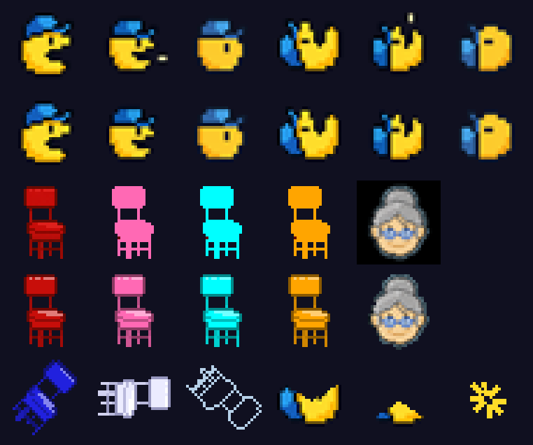

# 🎨 Arte e som

Toda a arte original (desenhada à mão) está preservada, sem alterações, em
[`assets-src/original/`](../assets-src/original/). Os arquivos que o jogo usa
(`coachman/assets/`) são **gerados** a partir dela por um script:

```bash
pip install pillow        # e ter o ffmpeg instalado, para o áudio
python tools/build_assets.py
```

Assim qualquer melhoria é reproduzível e reversível: para mudar um sprite,
edite o original e rode o script de novo.



*Linhas 1–2: Coach-Man original × tratado. Linhas 3–4: cadeiras e vovó
originais × tratadas. Linha 5: quadros novos (cadeira assustada, piscando,
"espírito" da cadeira devorada e a animação de morte).*

## O que foi feito em cada sprite

| Sprite | Original | Tratamento |
|---|---|---|
| **Coach-Man** (12 quadros) | bordas com *anti-aliasing* (pixels semitransparentes que viram um "halo" borrado quando ampliados) e uma bolinha solta perto da boca | pixels quase transparentes removidos, pixels de borda viram contorno sólido azul-marinho, pixels soltos apagados → contorno nítido de pixel art |
| **Blinky** (8 quadros girando) | cadeira vermelha com sombreamento | sombreamento reduzido a **5 tons** (paleta limpa estilo 8-bit) |
| **Pinky, Inky, Clyde** | só a silhueta da cadeira, em cor chapada (com um pixel vermelho perdido) | o sombreamento do Blinky é reaplicado nas cores escolhidas para cada uma (rosa, ciano, laranja) → as quatro cadeiras com o mesmo nível de detalhe |
| **Cadeira assustada / piscando** | não existia | mesma cadeira nos tons azul do arcade (#2121DE) e branco |
| **Cadeira devorada** | não existia | só o contorno da cadeira, em azul-claro: o "espírito" que voa de volta para a casa (no arcade, só os olhos voltam) |
| **Morte do Coach-Man** | não existia | a "boca" abre até ele sumir, como no arcade, + um estouro final |
| **Power-ups** (X, Instagram, TikTok, YouTube) | ícones 20×20 | mantidos exatamente como desenhados |
| **Facebook, Discord, WhatsApp** | não existiam | desenhados em pixel art no mesmo estilo e tamanho (20×20, cantos arredondados). A cada fase, 4 dos 7 logos são sorteados |
| **"$"** (as bolinhas) | círculos brancos | um "$" verde de 5×7 pixels: prosperidade desbloqueada |
| **Vovó** (a "frutinha" de bônus) | 45×45 com fundo preto | fundo removido e reduzida para 30×30 |
| **Ícone do site** | `CoachmanEatingRight.png` com fundo cinza | fundo removido, ampliado sem suavização |
| **Paredes** | quadradinhos azuis | contornos arredondados desenhados por código, com linha dupla na borda externa e na casa, como no arcade ([`maze_renderer.py`](../coachman/game/ui/maze_renderer.py)) |

As cadeiras **giram** no ar (8 quadros de rotação) e o jogo desenha um rastro
de movimento atrás delas e uma leve flutuação: são **cadeiras voadoras**.

## Telas

* **Título:** o retrato `marcalHead.png` inteiro com o menu original
  (">Play<  Murro no fucin", ">Score<  Prosperidade Desbloqueada",
  ">Exit<  Vc não é homi pa isso") e a opção nova ">Help<  Mentoria gratuita".
* **Saída:** `marcalHead7.png` (no navegador não dá para fechar a aba, então a
  piada volta para o menu).
* **Fim de jogo:** a imagem da ambulância, como na versão original.
* Fonte: **Press Start 2P** (SIL Open Font License 1.1, licença incluída em
  `coachman/assets/fonts/OFL.txt`).

## Som

As faixas originais têm **voz humana**, então **não** passam por nenhuma
conversão para 8 bits nem para mono: são apenas compactadas de WAV
(17 MB) para **OGG Vorbis estéreo, 44,1 kHz, qualidade 7** (~2 MB), formato
recomendado para o navegador.

| Original | No jogo | Onde toca |
|---|---|---|
| `videoplayback_audio.wav` | `menu.ogg` | menu |
| `audio_extraido.wav` | `gameplay.ogg` | durante o jogo |
| `audio_cortado.wav` | `highscores.ogg` | placar e novo recorde |

> O pygbag, por padrão, "otimiza" o áudio convertendo para **mono** e as
> imagens para PNG com perda. Por isso o build usa `--no_opt`.

Os efeitos sonoros (comer "$", power-up, cadeirada ao devorar uma cadeira,
morte, vovó, vida extra, menu) são **sintetizados** pelo próprio script em
16 bits / 44,1 kHz — sons suaves, sem estilo chiptune e sem material de
terceiros. `M` liga/desliga o som.
