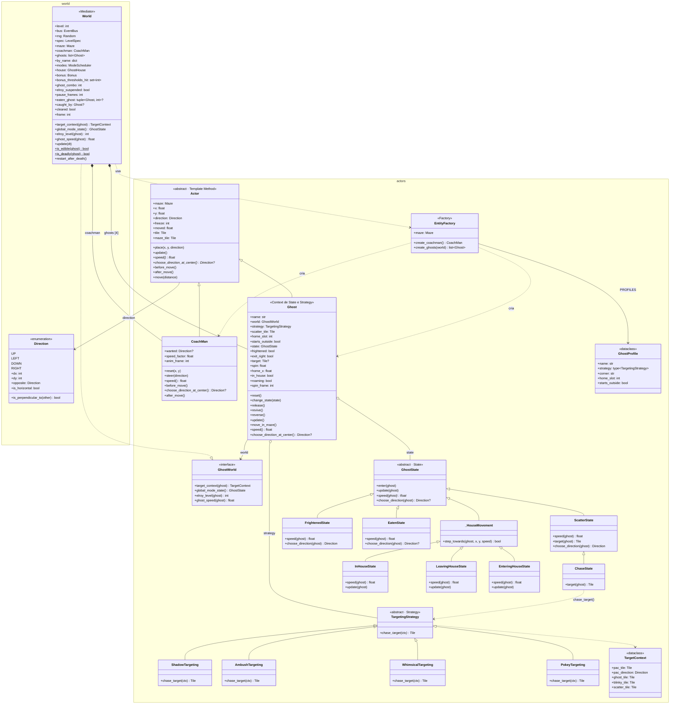
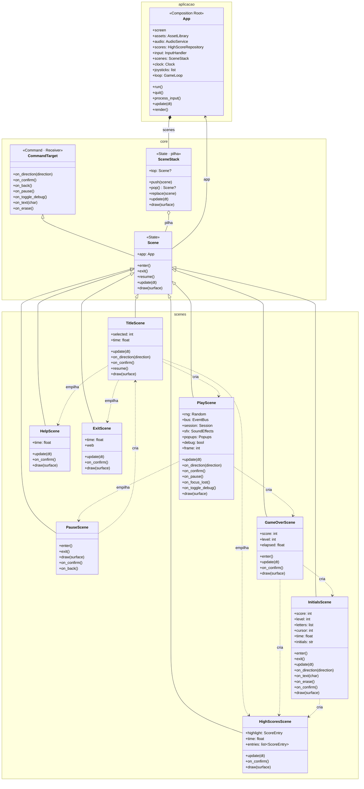

# 📐 Diagramas de classes

Gerados automaticamente a partir do código por [`tools/class_diagram.py`](../tools/class_diagram.py) (classes, herança, atributos e métodos públicos lidos do código; associações e papéis nos padrões declarados no script). O GitHub desenha os blocos Mermaid abaixo; as mesmas imagens em SVG/PNG ficam em [`img/diagramas/`](img/diagramas/).

**Legenda (UML):**

| Desenho | Significado |
|---|---|
| linha cheia com triângulo vazado | herança (é um) |
| linha cheia com losango cheio | composição (o dono cria e guarda) |
| linha cheia com losango vazado | agregação (recebe pronto e guarda) |
| linha cheia com seta | associação (conhece) |
| linha tracejada com seta | dependência (usa ou cria) |
| linha tracejada com triângulo vazado | implementa a interface |
| *itálico* | método abstrato |
| sublinhado | método estático / de classe |
| `«...»` | tipo da classe e o seu papel no padrão de projeto |

Só os membros públicos aparecem; métodos internos (começados por `_`) foram omitidos.

Para regenerar:

```bash
python tools/class_diagram.py                       # .mmd + este arquivo
npm install mermaid@11 playwright && node tools/render_diagrams.js   # SVG/PNG
```

## Visão geral (todas as classes)

Todas as classes do jogo, agrupadas por pacote, com herança e associações. Os membros estão nos diagramas por área, logo abaixo.

```mermaid
classDiagram
    direction LR
    namespace actors {
        class Actor {
            <<abstract · Template Method>>
        }
        class CoachMan {
        }
        class GhostProfile {
            <<dataclass>>
        }
        class EntityFactory {
            <<Factory>>
        }
        class GhostWorld {
            <<interface>>
        }
        class Ghost {
            <<Context de State e Strategy>>
        }
        class GhostState {
            <<abstract · State>>
        }
        class ScatterState {
        }
        class ChaseState {
        }
        class FrightenedState {
        }
        class EatenState {
        }
        class _HouseMovement {
        }
        class InHouseState {
        }
        class LeavingHouseState {
        }
        class EnteringHouseState {
        }
        class TargetContext {
            <<dataclass>>
        }
        class TargetingStrategy {
            <<abstract · Strategy>>
        }
        class ShadowTargeting {
        }
        class AmbushTargeting {
        }
        class WhimsicalTargeting {
        }
        class PokeyTargeting {
        }
    }
    namespace aplicacao {
        class App {
            <<Composition Root>>
        }
        class LevelSpec {
            <<dataclass>>
        }
    }
    namespace core {
        class AssetLibrary {
            <<Flyweight>>
        }
        class AudioService {
            <<abstract · Facade>>
        }
        class NullAudio {
            <<Null Object>>
        }
        class PygameAudio {
            <<Singleton>>
        }
        class CommandTarget {
            <<Command · Receiver>>
        }
        class Command {
            <<abstract · Command>>
        }
        class DirectionCommand {
        }
        class ConfirmCommand {
        }
        class BackCommand {
        }
        class PauseCommand {
        }
        class ToggleDebugCommand {
        }
        class TextCommand {
        }
        class EraseCommand {
        }
        class AppCommand {
        }
        class InputHandler {
            <<Command · Invoker>>
        }
        class EventBus {
            <<Observer · Subject>>
        }
        class DotEaten {
            <<event>>
        }
        class EnergizerEaten {
            <<event>>
        }
        class GhostEaten {
            <<event>>
        }
        class CoachManCaught {
            <<event>>
        }
        class BonusSpawned {
            <<event>>
        }
        class BonusEaten {
            <<event>>
        }
        class ModeChanged {
            <<event>>
        }
        class FrightStarted {
            <<event>>
        }
        class FrightEnded {
            <<event>>
        }
        class ExtraLife {
            <<event>>
        }
        class LevelCleared {
            <<event>>
        }
        class GameLoop {
            <<Game Loop>>
        }
        class Scene {
            <<State>>
        }
        class SceneStack {
            <<State · pilha>>
        }
    }
    namespace persistence {
        class ScoreEntry {
            <<dataclass>>
        }
        class HighScoreRepository {
            <<abstract · Repository>>
        }
        class InMemoryHighScoreRepository {
        }
        class SqliteHighScoreRepository {
        }
        class BrowserHighScoreRepository {
        }
    }
    namespace scenes {
        class ExitScene {
        }
        class GameOverScene {
        }
        class HelpScene {
        }
        class HighScoresScene {
        }
        class InitialsScene {
        }
        class PauseScene {
        }
        class Phase {
            <<enumeration>>
        }
        class SoundEffects {
            <<Observer · assinante>>
        }
        class Popups {
            <<Observer · assinante>>
        }
        class PlayScene {
        }
        class TitleScene {
        }
    }
    namespace systems {
        class GhostHouse {
        }
        class ModeScheduler {
        }
        class Session {
            <<Observer · assinante>>
        }
    }
    namespace world {
        class Direction {
            <<enumeration>>
        }
        class MazeDefinition {
            <<dataclass>>
        }
        class Maze {
            <<dataclass>>
        }
        class Bonus {
        }
        class World {
            <<Mediator>>
        }
    }
    Actor <|-- CoachMan
    Actor <|-- Ghost
    GhostState <|-- ScatterState
    ScatterState <|-- ChaseState
    GhostState <|-- FrightenedState
    GhostState <|-- EatenState
    GhostState <|-- _HouseMovement
    _HouseMovement <|-- InHouseState
    _HouseMovement <|-- LeavingHouseState
    _HouseMovement <|-- EnteringHouseState
    TargetingStrategy <|-- ShadowTargeting
    TargetingStrategy <|-- AmbushTargeting
    TargetingStrategy <|-- WhimsicalTargeting
    TargetingStrategy <|-- PokeyTargeting
    AudioService <|-- NullAudio
    AudioService <|-- PygameAudio
    Command <|-- DirectionCommand
    Command <|-- ConfirmCommand
    Command <|-- BackCommand
    Command <|-- PauseCommand
    Command <|-- ToggleDebugCommand
    Command <|-- TextCommand
    Command <|-- EraseCommand
    Command <|-- AppCommand
    CommandTarget <|-- Scene
    HighScoreRepository <|-- InMemoryHighScoreRepository
    HighScoreRepository <|-- SqliteHighScoreRepository
    HighScoreRepository <|-- BrowserHighScoreRepository
    Scene <|-- ExitScene
    Scene <|-- GameOverScene
    Scene <|-- HelpScene
    Scene <|-- HighScoresScene
    Scene <|-- InitialsScene
    Scene <|-- PauseScene
    Scene <|-- PlayScene
    Scene <|-- TitleScene
    App *-- GameLoop : loop
    App *-- SceneStack : scenes
    App *-- InputHandler : input
    App *-- AssetLibrary : assets
    App o-- AudioService : audio
    App o-- HighScoreRepository : scores
    SceneStack o-- Scene : pilha
    Scene --> App : app
    InputHandler ..> Command : traduz eventos em
    Command ..> CommandTarget : execute(alvo)
    HighScoreRepository ..> ScoreEntry
    PlayScene *-- World : world
    PlayScene *-- Session : session
    PlayScene *-- EventBus : bus
    PlayScene *-- SoundEffects : sfx
    PlayScene *-- Popups : popups
    PlayScene --> Phase : phase
    TitleScene ..> PlayScene : cria
    TitleScene ..> HighScoresScene : empilha
    TitleScene ..> HelpScene : empilha
    TitleScene ..> ExitScene : empilha
    PlayScene ..> PauseScene : empilha
    PlayScene ..> GameOverScene : cria
    GameOverScene ..> InitialsScene : cria
    GameOverScene ..> HighScoresScene : cria
    InitialsScene ..> HighScoresScene : cria
    PauseScene ..> TitleScene : cria
    SoundEffects --> AudioService : audio
    SoundEffects ..> EventBus : assina
    Popups ..> EventBus : assina
    Session ..> EventBus : assina / publica
    World *-- Maze : maze
    World *-- CoachMan : coachman
    World *-- Ghost : ghosts [4]
    World *-- ModeScheduler : modes
    World *-- GhostHouse : house
    World *-- Bonus : bonus
    World --> LevelSpec : spec
    World --> EventBus : publica
    World ..> EntityFactory : usa
    World ..|> GhostWorld
    Maze --> MazeDefinition : definition
    GhostHouse --> Ghost : libera
    GhostHouse --> LevelSpec : spec
    Actor --> Maze : maze
    Actor --> Direction : direction
    Ghost o-- GhostState : state
    Ghost o-- TargetingStrategy : strategy
    Ghost --> GhostWorld : world
    ChaseState ..> TargetingStrategy : chase_target()
    TargetingStrategy ..> TargetContext
    EntityFactory ..> CoachMan : cria
    EntityFactory ..> Ghost : cria
    EntityFactory --> GhostProfile : PROFILES
```



<details><summary>Código Mermaid</summary>



</details>

## Atores e IA das cadeiras (Template Method, State, Strategy, Factory)

O núcleo do jogo: o movimento comum (`Actor`), a cadeira como contexto de dois padrões (`GhostState` e `TargetingStrategy`) e a fábrica que monta tudo.



<details><summary>Código Mermaid</summary>



</details>

## Uma fase em jogo (Mediator, Observer)

O `World` coordena labirinto, atores e sistemas e publica eventos no `EventBus`; placar, sons e pop-ups são assinantes.

```mermaid
classDiagram
    direction TB
    namespace scenes {
        class PlayScene {
            +rng: Random
            +bus: EventBus
            +session: Session
            +sfx: SoundEffects
            +popups: Popups
            +debug: bool
            +frame: int
            +update(dt)
            +on_direction(direction)
            +on_confirm()
            +on_pause()
            +on_focus_lost()
            +on_toggle_debug()
            +draw(surface)
        }
        class Phase {
            <<enumeration>>
            INTRO
            READY
            PLAYING
            DYING
            CLEARED
            GAME_OVER
        }
        class SoundEffects {
            <<Observer · assinante>>
            +audio: AudioService
        }
        class Popups {
            <<Observer · assinante>>
            +items: list~list~
            +update(dt)
            +clear()
        }
    }
    namespace world {
        class World {
            <<Mediator>>
            +level: int
            +bus: EventBus
            +rng: Random
            +spec: LevelSpec
            +maze: Maze
            +coachman: CoachMan
            +ghosts: list~Ghost~
            +by_name: dict
            +modes: ModeScheduler
            +house: GhostHouse
            +bonus: Bonus
            +bonus_thresholds_hit: set~int~
            +ghost_combo: int
            +elroy_suspended: bool
            +pause_frames: int
            +eaten_ghost: tuple~Ghost, int~?
            +caught_by: Ghost?
            +cleared: bool
            +frame: int
            +target_context(ghost) TargetContext
            +global_mode_state() GhostState
            +elroy_level(ghost) int
            +ghost_speed(ghost) float
            +update(dt)
            +is_edible(ghost)$ bool
            +is_deadly(ghost)$ bool
            +restart_after_death()
        }
        class Maze {
            <<dataclass>>
            +definition: MazeDefinition
            +cols: int
            +rows: int
            +walls: set~Tile~
            +doors: set~Tile~
            +dots: set~Tile~
            +energizers: dict~Tile, int~
            +tunnel_tiles: set~Tile~
            +total_food: int
            +food_left: int
            +food_eaten: int
            +door_row: int
            +house_center_x: float
            +house_exit_y: float
            +house_inside_y: float
            +house_exit_tiles: set~Tile~
            +from_definition(definition)$ Maze
            +wrap_col(col) int
            +is_wall(col, row) bool
            +is_door(col, row) bool
            +is_tunnel(col, row) bool
            +pacman_can_enter(col, row) bool
            +ghost_can_enter(col, row) bool
            +exits(tile) list~Direction~
            +eat(tile) str?
            +house_slot_x(slot) float
        }
        class MazeDefinition {
            <<dataclass>>
            +name: str
            +subtitle: str
            +layout: tuple~str, ...~
            +wall_color: tuple~int, int, int~
            +no_up_tiles: tuple~Tile, ...~
            +pacman_start: tuple~float, float~
            +bonus_position: tuple~float, float~
        }
        class Bonus {
            +x: float
            +y: float
            +time_left: float
            +active: bool
            +spawn(seconds)
            +hide()
            +update(dt)
        }
    }
    namespace systems {
        class ModeScheduler {
            +durations: tuple~float, ...~
            +index: int
            +elapsed: float
            +fright_left: float
            +fright_total: float
            +fright_flashes: int
            +mode: str
            +time_left: float
            +frightened: bool
            +flashing: bool
            +start_fright(seconds, flashes)
            +update(dt) list~str~
        }
        class GhostHouse {
            +spec: LevelSpec
            +ghosts: dict
            +counters: dict
            +use_global: bool
            +global_counter: int
            +idle: float
            +preferred() Ghost?
            +on_life_lost()
            +on_dot_eaten()
            +update(dt)
        }
        class Session {
            <<Observer · assinante>>
            +bus: EventBus
            +score: int
            +high_score: int
            +lives: int
            +level: int
            +extra_life_awarded: bool
            +add_points(points)
            +lose_life() bool
        }
    }
    namespace aplicacao {
        class LevelSpec {
            <<dataclass>>
            +level: int
            +bonus_points: int
            +pac_speed: float
            +pac_fright_speed: float
            +ghost_speed: float
            +ghost_tunnel_speed: float
            +ghost_fright_speed: float
            +elroy1_dots: int
            +elroy1_speed: float
            +elroy2_dots: int
            +elroy2_speed: float
            +fright_time: float
            +fright_flashes: int
            +mode_durations: tuple~float, ...~
            +dot_limits: dict~str, int~
            +house_idle_limit: float
        }
    }
    namespace core {
        class EventBus {
            <<Observer · Subject>>
            +subscribe(event_type, handler) Callable
            +publish(event)
            +clear()
        }
        class DotEaten {
            <<event>>
            +tile: tuple~int, int~
            +food_left: int
        }
        class EnergizerEaten {
            <<event>>
            +tile: tuple~int, int~
            +food_left: int
        }
        class GhostEaten {
            <<event>>
            +ghost: str
            +points: int
            +position: tuple~float, float~
        }
        class CoachManCaught {
            <<event>>
            +ghost: str
        }
        class BonusSpawned {
            <<event>>
            +position: tuple~float, float~
        }
        class BonusEaten {
            <<event>>
            +points: int
            +position: tuple~float, float~
        }
        class ModeChanged {
            <<event>>
            +mode: str
        }
        class FrightStarted {
            <<event>>
            +seconds: float
        }
        class FrightEnded {
            <<event>>
        }
        class ExtraLife {
            <<event>>
            +lives: int
        }
        class LevelCleared {
            <<event>>
            +level: int
        }
        class AudioService {
            <<abstract · Facade>>
            +play_music(name, loops)*
            +stop_music()*
            +pause_music()
            +resume_music()
            +play_sfx(name)*
            +set_muted(muted)*
            +toggle_mute() bool
        }
    }
    PlayScene *-- World : world
    PlayScene *-- Session : session
    PlayScene *-- EventBus : bus
    PlayScene *-- SoundEffects : sfx
    PlayScene *-- Popups : popups
    PlayScene --> Phase : phase
    SoundEffects --> AudioService : audio
    SoundEffects ..> EventBus : assina
    Popups ..> EventBus : assina
    Session ..> EventBus : assina / publica
    World *-- Maze : maze
    World *-- ModeScheduler : modes
    World *-- GhostHouse : house
    World *-- Bonus : bonus
    World --> LevelSpec : spec
    World --> EventBus : publica
    Maze --> MazeDefinition : definition
    GhostHouse --> LevelSpec : spec
```



<details><summary>Código Mermaid</summary>



</details>

## Motor e infraestrutura (Game Loop, Command, Facade, Singleton, Null Object, Repository, Flyweight)

Tudo o que não sabe nada de Pac-Man: laço, entrada, telas, recursos, som e recordes.

```mermaid
classDiagram
    direction TB
    namespace aplicacao {
        class App {
            <<Composition Root>>
            +screen
            +assets: AssetLibrary
            +audio: AudioService
            +scores: HighScoreRepository
            +input: InputHandler
            +scenes: SceneStack
            +clock: Clock
            +joysticks: list
            +loop: GameLoop
            +run()
            +quit()
            +process_input()
            +update(dt)
            +render()
        }
    }
    namespace core {
        class GameLoop {
            <<Game Loop>>
            +step: float
            +process_input: Callable
            +update: Callable
            +render: Callable
            +tick: Callable
            +running: bool
            +run()
            +stop()
        }
        class SceneStack {
            <<State · pilha>>
            +top: Scene?
            +push(scene)
            +pop() Scene?
            +replace(scene)
            +update(dt)
            +draw(surface)
        }
        class Scene {
            <<State>>
            +app: App
            +enter()
            +exit()
            +resume()
            +update(dt)
            +draw(surface)
        }
        class CommandTarget {
            <<Command · Receiver>>
            +on_direction(direction)
            +on_confirm()
            +on_back()
            +on_pause()
            +on_toggle_debug()
            +on_text(char)
            +on_erase()
        }
        class Command {
            <<abstract · Command>>
            +execute(target)*
        }
        class DirectionCommand {
            +direction: Direction
            +execute(target)
        }
        class ConfirmCommand {
            +execute(target)
        }
        class BackCommand {
            +execute(target)
        }
        class PauseCommand {
            +execute(target)
        }
        class ToggleDebugCommand {
            +execute(target)
        }
        class TextCommand {
            +char: str
            +execute(target)
        }
        class EraseCommand {
            +execute(target)
        }
        class AppCommand {
            +action: str
            +execute(target)
        }
        class InputHandler {
            <<Command · Invoker>>
            +keymap
            +text_mode: bool
            +translate(event) list~Command~
        }
        class AssetLibrary {
            <<Flyweight>>
            +base_dir: Path
            +path(relative) str
            +load_atlas(image, index)
            +frame(name) Surface
            +frames(prefix) list~Surface~
            +image(relative) Surface
            +font(size) Font
            +text(text, size, color) Surface
        }
        class AudioService {
            <<abstract · Facade>>
            +play_music(name, loops)*
            +stop_music()*
            +pause_music()
            +resume_music()
            +play_sfx(name)*
            +set_muted(muted)*
            +toggle_mute() bool
        }
        class PygameAudio {
            <<Singleton>>
            +base_dir: Path
            +current: str?
            +sounds: dict~str, Sound~
            +play_music(name, loops)
            +stop_music()
            +pause_music()
            +resume_music()
            +play_sfx(name)
            +set_muted(muted)
        }
        class NullAudio {
            <<Null Object>>
            +played: list~str~
            +play_music(name, loops)
            +stop_music()
            +play_sfx(name)
            +set_muted(muted)
        }
    }
    namespace persistence {
        class HighScoreRepository {
            <<abstract · Repository>>
            +top(limit)* list~ScoreEntry~
            +add(entry)*
            +best() int
            +qualifies(score) bool
        }
        class InMemoryHighScoreRepository {
            +top(limit) list~ScoreEntry~
            +add(entry)
        }
        class SqliteHighScoreRepository {
            +top(limit) list~ScoreEntry~
            +add(entry)
        }
        class BrowserHighScoreRepository {
            +top(limit) list~ScoreEntry~
            +add(entry)
        }
        class ScoreEntry {
            <<dataclass>>
            +initials: str
            +score: int
            +level: int
            +day: str
            +new(initials, score, level)$ ScoreEntry
        }
    }
    CommandTarget <|-- Scene
    Command <|-- DirectionCommand
    Command <|-- ConfirmCommand
    Command <|-- BackCommand
    Command <|-- PauseCommand
    Command <|-- ToggleDebugCommand
    Command <|-- TextCommand
    Command <|-- EraseCommand
    Command <|-- AppCommand
    AudioService <|-- PygameAudio
    AudioService <|-- NullAudio
    HighScoreRepository <|-- InMemoryHighScoreRepository
    HighScoreRepository <|-- SqliteHighScoreRepository
    HighScoreRepository <|-- BrowserHighScoreRepository
    App *-- GameLoop : loop
    App *-- SceneStack : scenes
    App *-- InputHandler : input
    App *-- AssetLibrary : assets
    App o-- AudioService : audio
    App o-- HighScoreRepository : scores
    SceneStack o-- Scene : pilha
    Scene --> App : app
    InputHandler ..> Command : traduz eventos em
    Command ..> CommandTarget : execute(alvo)
    HighScoreRepository ..> ScoreEntry
```



<details><summary>Código Mermaid</summary>



</details>

## Telas (State com pilha)

Cada tela é um estado da aplicação; as setas tracejadas mostram para onde cada uma leva.



<details><summary>Código Mermaid</summary>



</details>
