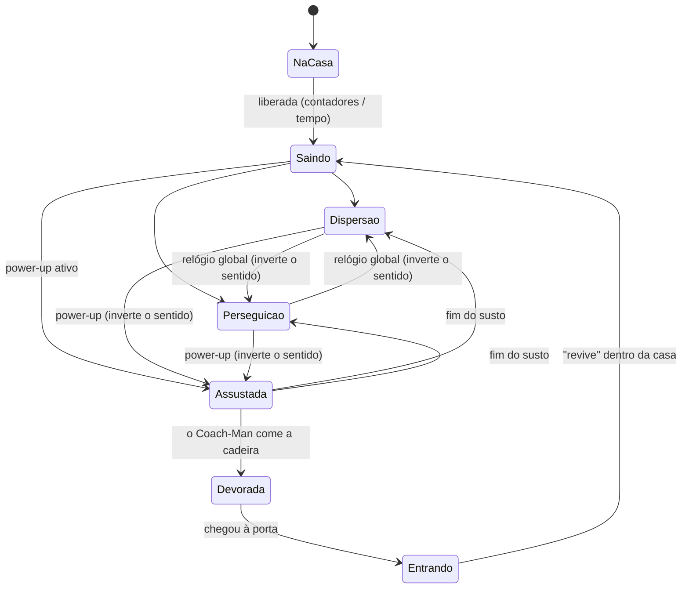

# 🪑 A IA das cadeiras voadoras

> No Coach-Man os fantasmas são **cadeiras voadoras**. Por dentro, elas
> seguem **exatamente** as regras dos fantasmas do Pac-Man original
> (Namco, 1980) — e a versão antiga deste projeto, que usava A\* para
> perseguir o jogador, foi trocada por esse algoritmo. Este documento
> explica como ele funciona e onde cada regra está no código.

**Dica:** durante o jogo aperte **TAB** (modo *Raio-X*) para ver o alvo de
cada cadeira em tempo real.


---

## 1. A grande ideia: ninguém "procura caminho"

O mais surpreendente da IA do Pac-Man é que ela é **simples**. As cadeiras
não calculam o caminho mais curto (nada de A\*, BFS ou Dijkstra). Cada uma tem
apenas um **tile-alvo** e, a cada cruzamento, faz uma escolha *gulosa*:

1. olha as saídas do tile onde está;
2. descarta a saída de onde veio (**cadeira nunca dá meia-volta por conta
   própria**) e as paredes;
3. para cada saída que sobrou, mede a **distância em linha reta** entre o
   *tile vizinho* naquela direção e o alvo;
4. vai pela saída de **menor distância**. Empate? Vence a ordem
   **cima → esquerda → baixo → direita**.

```
            alvo 🎯 (6, 0)
                 |
     . . . . . . ↑ . . . .        cadeira em (6,5) vindo da esquerda (→)
               ← 🪑 →              saídas: ↑ (6,4)  ↓ (6,6)  → (7,5)   (← proibido)
     . . . . . . ↓ . . . .        distâncias²: ↑ 16   ↓ 36   → 26  ⇒ sobe
```

Código: [`choose_toward()` em `ghost_states.py`](../coachman/game/actors/ghost_states.py)

```python
for d in PRIORITY:                      # cima, esquerda, baixo, direita
    if d is ghost.direction.opposite:    # 1) nunca voltar
        continue
    if restrict_up and d is UP and tile in no_up_tiles:   # 3) "zonas sem subida"
        continue
    if not maze.ghost_can_enter(vizinho):                 # 2) paredes e porta
        continue
    dist = (nc - tc) ** 2 + (nr - tr) ** 2                # 4) distância²
    if dist < best_dist:                                  # "<" estrito = desempate
        best, best_dist = d, dist
```

Por ser guloso, o caminho **nem sempre é o melhor** — e é justamente isso que
dá "personalidade" às cadeiras e permite que o jogador as engane.

> **Por que distância ao quadrado?** A raiz quadrada não muda a ordem entre
> as distâncias, então comparar `dx² + dy²` dá o mesmo resultado e é mais
> barato.

### Zonas "proibido subir"

Em dois pontos do labirinto clássico (acima da casa e acima do início do
jogador) as cadeiras **não podem virar para cima** nos modos de dispersão e
perseguição. Por isso essas áreas são esconderijos relativamente seguros.
Cada labirinto declara as suas em `no_up_tiles`
([`maze_data.py`](../coachman/game/world/maze_data.py)).

---

## 2. Quatro personalidades = quatro alvos (padrão **Strategy**)

Todas as cadeiras usam o algoritmo acima. A **única** diferença entre elas é
**como calculam o alvo** no modo perseguição. Cada regra é uma classe que
implementa `TargetingStrategy` ([`targeting.py`](../coachman/game/actors/targeting.py)):

| Cadeira | Cor | Apelido (arcade) | Alvo na perseguição |
|---|---|---|---|
| **Blinky** | 🔴 vermelha | *Shadow* — "Perseguidora" | o tile do Coach-Man |
| **Pinky** | 🩷 rosa | *Speedy* — "Emboscada" | 4 tiles **à frente** do Coach-Man |
| **Inky** | 🩵 ciano | *Bashful* — "Imprevisível" | vetor Blinky → (2 à frente), **dobrado** |
| **Clyde** | 🟠 laranja | *Pokey* — "Desligada" | o Coach-Man se estiver a **8+ tiles**; senão, o próprio canto |

### Blinky — a sombra

```
alvo = tile do Coach-Man
```
Persegue direto. É a mais perigosa quando está atrás de você.

### Pinky — a emboscada

```
alvo = tile do Coach-Man + 4 × direção do Coach-Man
```
Ela mira onde você **vai estar**, tentando te pegar pela frente. Truque: andar
na direção dela faz o alvo ficar *atrás* dela, e ela desvia.

**O bug do arcade:** quando o Pac-Man olha **para cima**, um estouro de 8 bits
no código original desloca o alvo também 4 tiles **para a esquerda**. O jogo
reproduz esse bug por fidelidade (`REPRODUCE_ARCADE_OVERFLOW_BUG = True`); dá
para desligar e ver a diferença.

```
olhando para a direita →          olhando para cima ↑ (com o bug)
                                   🎯 . . . .
 C → . . . 🎯                      . . . . ↑
                                   . . . . ↑
                                   . . . . C
```

### Inky — o imprevisível

```
pivô = tile do Coach-Man + 2 × direção   (com o mesmo bug "para cima")
alvo = pivô + (pivô − tile do Blinky)     ⇒  2·pivô − Blinky
```
O Inky usa o **Blinky** como referência: traça o vetor do Blinky até o pivô e
o dobra. Se o Blinky está colado em você, o Inky fecha o cerco pelo outro
lado; se o Blinky está longe, o alvo do Inky vai parar longe também e ele
parece andar a esmo.

```
    B (Blinky)
     \
      \        vetor Blinky → pivô
       ●  pivô (2 à frente de C)
        \
         \     o mesmo vetor de novo
          🎯   alvo do Inky
```

### Clyde — a desligada

```
se distância(Clyde, Coach-Man) ≥ 8 tiles:  alvo = tile do Coach-Man
senão:                                     alvo = canto de dispersão do Clyde
```
De longe ela persegue como o Blinky; quando chega perto, "desiste" e volta para
o canto inferior esquerdo. Fica oscilando — por isso parece distraída.

---

## 3. Os modos (padrão **State**)

Cada cadeira é um *contexto* que delega o comportamento ao seu **estado**
atual ([`ghost_states.py`](../coachman/game/actors/ghost_states.py)). Trocar
de comportamento é trocar de objeto-estado — sem `if modo == ...` espalhado.



| Estado | Alvo | Velocidade (fase 1) | Mata o jogador? |
|---|---|---|---|
| **Dispersão** | o canto da cadeira (fora do mapa) | 75% | sim |
| **Perseguição** | o da estratégia (tabela acima) | 75% | sim |
| **Assustada** (azul) | nenhum: direção **pseudoaleatória** em cada cruzamento | 50% | não — é comida |
| **Devorada** (só o "espírito" da cadeira) | a porta da casa | 170% | não |
| **Na casa / Saindo / Entrando** | movimento fixo, fora da grade | 50% | — |

### Dispersão × perseguição: o relógio global

As cadeiras **não** perseguem o tempo todo. Um cronômetro, igual para todas,
alterna os modos ([`mode_scheduler.py`](../coachman/game/systems/mode_scheduler.py)):

| Fase | Disp. | Pers. | Disp. | Pers. | Disp. | Pers. | Disp. | Pers. |
|---|---|---|---|---|---|---|---|---|
| 1 | 7 s | 20 s | 7 s | 20 s | 5 s | 20 s | 5 s | ∞ |
| 2–4 | 7 s | 20 s | 7 s | 20 s | 5 s | 1033 s | 1/60 s | ∞ |
| 5+ | 5 s | 20 s | 5 s | 20 s | 5 s | 1037 s | 1/60 s | ∞ |

* Toda troca de modo faz as cadeiras **darem meia-volta** — é o sinal visual
  de que o modo mudou.
* Na dispersão, cada cadeira mira um canto **fora** do labirinto. Como não
  consegue chegar lá, ela fica dando voltas no bloco mais próximo:

```
 Pinky (2,-3) 🎯                         🎯 Blinky (25,-3)
   ┌──────────────────────────────────────────┐
   │  ↺                                    ↻  │
   │                                          │
   │  ↻                                    ↺  │
   └──────────────────────────────────────────┘
 Clyde (0,32) 🎯                         🎯 Inky (27,32)
```

* Durante o modo assustado o cronômetro **pausa** e só volta a contar
  quando o susto acaba.

### Modo assustado

Ao comer um power-up (os logos das redes sociais 📱): todas as cadeiras
fora da casa dão meia-volta e ficam azuis por um tempo que **diminui a cada
fase** (6 s na fase 1… 0 s a partir da 19, quando elas só dão meia-volta).
Perto do fim elas **piscam em branco**. Cada cadeira devorada com o mesmo
power-up vale o dobro da anterior: **200 → 400 → 800 → 1600**.

A direção "aleatória" usa um gerador pseudoaleatório (`random.Random` com
semente, para os testes serem reproduzíveis): sorteia uma direção e, se ela
for inválida, tenta as próximas na ordem cima, esquerda, baixo, direita.

---

## 4. Quem sai da casa e quando

[`ghost_house.py`](../coachman/game/systems/ghost_house.py)

* **Blinky** já começa do lado de fora.
* Os outros saem na ordem **Pinky → Inky → Clyde**, controlados por
  **contadores de "$"**: só o contador da primeira cadeira da fila anda.

| Fase | Pinky | Inky | Clyde |
|---|---|---|---|
| 1 | 0 | 30 | 60 |
| 2 | 0 | 0 | 50 |
| 3+ | 0 | 0 | 0 |

* **Depois que o Coach-Man morre** vale um **contador global**: Pinky sai com
  7 "$", Inky com 17 e Clyde com 32.
* **Anti-acampamento:** se o jogador passar **4 s** (3 s a partir da fase 5)
  sem comer nada, a próxima cadeira é liberada à força.

## 5. "Cruise Elroy": o Blinky acelera

Quando restam poucas bolinhas, o Blinky fica mais rápido (*Elroy 1*) e depois
mais rápido ainda (*Elroy 2*) — na fase 1, com 20 e 10 "$" restantes. Nesse
estado ele **ignora a dispersão** e continua perseguindo. Após uma morte do
jogador, o Elroy fica suspenso até o Clyde sair da casa.

## 6. Velocidades e o "jeitinho" do jogador

Tudo em percentual da velocidade máxima do arcade (75,76 px/s em tiles de
8 px ≈ 9,5 tiles/s) — tabela completa em [`levels.py`](../coachman/game/levels.py):

| Fase | Coach-Man | Cadeiras | No túnel | Assustadas | Susto |
|---|---|---|---|---|---|
| 1 | 80% | 75% | 40% | 50% | 6 s |
| 2–4 | 90% | 85% | 45% | 55% | 5 → 3 s |
| 5–20 | 100% | 95% | 50% | 60% | 2 → 0 s |

Vantagens do jogador, todas implementadas:

* **Túneis** deixam as cadeiras muito mais lentas.
* **Curva antecipada (*cornering*)**: o Coach-Man pode começar a virar antes
  do centro do cruzamento e anda na diagonal até se alinhar — ganhando alguns
  pixels por curva. As cadeiras não sabem fazer isso.
  ([`coachman.py`](../coachman/game/actors/coachman.py))
* Comer **"$" custa 1 quadro** (power-up custa 3): corredores vazios são mais
  rápidos que corredores cheios — útil para fugir.

## 7. Colisão

Igual ao arcade: Coach-Man e cadeira **colidem quando ocupam o mesmo tile**.
A checagem acontece depois que o jogador anda e de novo depois que as
cadeiras andam, no mesmo quadro.

## 8. Como isso é testado

`tests/test_targeting.py` verifica os quatro alvos (incluindo o bug de
estouro), `tests/test_ghost_ai.py` verifica a escolha gulosa, o desempate, a
proibição de meia-volta e de subida, e que nenhuma cadeira atravessa paredes
em uma partida simulada de 1 minuto; `tests/test_systems.py` confere o
relógio de modos e a liberação da casa quadro a quadro.

## Referências

* Jamey Pittman — *The Pac-Man Dossier*.
  <https://www.gamedeveloper.com/design/the-pac-man-dossier>
* Chad Birch — *Understanding Pac-Man Ghost Behavior*.
  <https://gameinternals.com/understanding-pac-man-ghost-behavior>
* Gamma, Helm, Johnson e Vlissides — *Design Patterns: Elements of Reusable
  Object-Oriented Software* (1994): **State** (p. 305) e **Strategy** (p. 315).
